  

# 🚀 Awesome Collaboration Tool Embedded Apps (MS Teams)

### ⚡ Curated Directory of Enterprise SaaS Solutions, Developer SDKs & Open-Source Projects for Collaborative Workspace Apps

  
  
  
  
  
  
  

  <em>A developer and architect resource for embedding CRM records, contract intelligence, project workflows, messaging extensions, and conversational AI bots directly into Microsoft Teams, Slack, and modern unified workspaces.</em>

---

## 📌 Table of Contents
- [📖 Overview & SEO Summary](#-overview--seo-summary)
- [📊 Sector Overview & Market Dynamics](#-sector-overview--market-dynamics)
- [🏢 SaaS / Hosted Platforms](#-saas--hosted-platforms)
- [💻 Open-Source GitHub Projects](#-open-source-github-projects)
  - [🛠️ Frameworks for Building Custom Systems](#%EF%B8%8F-frameworks-for-building-custom-systems)
- [🤝 How to Contribute](#-how-to-contribute)
- [💖 Support & Sponsorship](#-support--sponsorship)
- [⭐ Star History](#-star-history)
- [⚠️ Disclaimer](#%EF%B8%8F-disclaimer)

---

## 📖 Overview & SEO Summary

This curated list compiles the premier **Microsoft Teams Embedded Apps**, **collaborative workspace integrations**, and **open-source Teams developer toolkits**. Whether you are looking for enterprise SaaS solutions to bring Salesforce, Icertis, Jira, or Workday into Microsoft 365, or seeking open-source SDKs like **TeamsFx (Teams Toolkit)**, **Microsoft Teams AI Library**, **Adaptive Cards**, and **Matterbridge**, this repository serves as your comprehensive guide.

### 🔍 Key Integration Keywords
`microsoft-teams-apps` • `embedded-apps` • `teams-toolkit` • `adaptive-cards` • `bot-framework` • `collaboration-software` • `saas-integrations` • `workplace-automation` • `enterprise-crm-teams` • `open-source-teams`

---

## 📊 Sector Overview & Market Dynamics

The global team collaboration software sector is estimated at **$40.2B in 2025** and projected to reach **$44.6B in 2026** (scaling toward $85B+ by 2033 at ~9.7% CAGR). The market exhibits a **moderately concentrated, winner-take-most structure at the platform tier**—where a handful of mega-suite ecosystems (Microsoft, Google, Salesforce/Slack, Cisco, and Zoom) capture over 55–60% of total industry revenue—paired with a **highly fragmented long-tail ecosystem of specialized embedded SaaS apps and point solutions** competing across niche workflow, ticketing, and domain-specific integrations.

---

## 🏢 SaaS / Hosted Platforms

| Product | Company Valuation / Revenue | Description | Pricing (Starting) | Free Tier / Trial Limits |
|---------|-----------------------------|-------------|-------------------|--------------------------|
| **[Google Workspace Add-ons](https://workspace.google.com/marketplace)** | ~$3.55T Market Cap (Alphabet) / $350B+ Rev | Marketplace of add-ons for Gmail, Drive, Docs, Sheets, and Calendar. Open-source add-ons exist for mail merge, translation, and admin automation. | $6.00 per user/month (Business Starter, 1-yr commitment) | 14-day free trial (up to 10 users); marketplace has free add-ons |
| **[Webex Embedded Apps](https://www.webex.com/)** | ~$390B Market Cap (Cisco) / $54B+ Rev | Third-party apps embedded within Webex meetings and messaging. Includes integrations for project management, CRM, and ticketing. | $12.00 per license/month (Webex Meet, annual billing) | Free plan: up to 100 attendees, 40-minute meeting limit, 1 license |
| **[Slack Apps](https://slack.com/apps)** | ~$180B Market Cap (Salesforce) / Slack ~$2.5B ARR | Marketplace of 2,600+ apps embedding workflows from Salesforce, Jira, Google Drive, and custom internal tools into Slack channels. Slack provides open-source SDKs for building custom apps. | $7.25 per active user/month (Pro plan, annual billing) | Free plan: 90-day message/file history, 1 canvas/channel, 1:1 huddles |
| **[Salesforce for Teams](https://appexchange.salesforce.com/)** | ~$180B Market Cap / $38B+ Rev | Embeds Salesforce records, Chatter, and workflows into Teams channels. Allows users to view and update CRM data without leaving Teams. | $25.00 per user/month (Starter Suite, monthly or annual) | 30-day free trial with sample data and full Starter features |
| **[Workday Everywhere](https://www.workday.com/)** | ~$47B Market Cap / $8.4B+ Rev | Embeds Workday tasks and approvals into Teams. Users can complete HR and finance tasks directly within their collaboration hub. | ~$8.33 to $16.67 per employee/month ($100–$200/employee/yr base HCM, 3-yr minimum contract) | No self-serve free tier; sales-assisted pilot demo available |
| **[Atlassian Apps (Jira/Confluence)](https://marketplace.atlassian.com/)** | ~$38B Market Cap / $4.4B+ Rev | 5,000+ apps extending Jira and Confluence, many of which embed directly into Teams via connectors. Popular integrations include Jira Cloud for Teams, Confluence Cloud for Teams. | $7.75 per user/month (Jira Standard Cloud, monthly billing) | Free plan: up to 10 users, 2GB file storage, standard community support |
| **[Zoom Apps](https://www.zoom.com/)** | ~$27B Market Cap / $4.6B+ Rev | In-meeting apps that embed collaborative tools (whiteboards, notes, project boards) directly into Zoom meetings. | $12.49 per user/month (Zoom Workplace Pro, annual billing) | Free Basic plan: 40-minute meeting limit, up to 100 attendees, 3 editable boards |
| **[Zendesk for Teams](https://www.zendesk.com/)** | ~$10.2B PE Acquisition / ~$1.7B ARR | Embeds Zendesk tickets and support workflows into Teams. Enables agents to view, update, and respond to tickets from within Teams. | $19.00 per agent/month (Support Team plan, billed annually) | 14-day free trial with full Zendesk Suite Professional features |
| **[Icertis for Microsoft Teams](https://www.icertis.com/)** | ~$5B Private Valuation / ~$350M ARR | Embeds contract intelligence directly into Teams. Users can search contracts, view obligations, and receive alerts without leaving the collaboration hub. Part of Icertis' broader enterprise CLM platform. | ~$5,500 per month (~$65,000/yr starting departmental tier via Azure Marketplace 3-yr contract) | No public free tier; guided proof-of-concept / sandbox via enterprise sales |
| **[Asana for Teams](https://asana.com/apps/microsoft-teams)** | ~$2.5B Market Cap / $700M+ Rev | Embeds Asana tasks, projects, and notifications into Teams. Users can create tasks and view project status without switching tabs. | $10.99 per user/month (Starter plan, billed annually) | Free Personal plan: up to 10 teammates, unlimited tasks/projects/messages |

---

## 💻 Open-Source GitHub Projects

| Project | Star Badge | Description |
|---------|------------|-------------|
| **[microsoft/botframework-sdk](https://github.com/microsoft/botframework-sdk)** |  | Core Microsoft Bot Framework SDK repository for building enterprise-grade conversational bot experiences across Microsoft Teams, Web Chat, and Cortana. |
| **[42wim/matterbridge](https://github.com/42wim/matterbridge)** |  | Universal multi-protocol bridge connecting Microsoft Teams, Mattermost, Slack, Discord, Telegram, Matrix, IRC, and XMPP with bidirectional message relay and REST API support. |
| **[airweave-ai/airweave](https://github.com/airweave-ai/airweave)** |  | Unified AI knowledge integration layer that syncs Microsoft Teams conversations, documents, and messaging into a searchable vector index for AI agents and LLMs. |
| **[IsmaelMartinez/teams-for-linux](https://github.com/IsmaelMartinez/teams-for-linux)** |  | Widely used unofficial Microsoft Teams desktop client for Linux built on Electron, supporting screen sharing, custom CSS styling, and native notifications. |
| **[miroslavpejic85/mirotalksfu](https://github.com/miroslavpejic85/mirotalksfu)** |  | Self-hosted WebRTC video conferencing and embedded collaboration platform providing a modern, scalable open-source alternative to Microsoft Teams and Zoom. |
| **[Vexa-ai/vexa](https://github.com/Vexa-ai/vexa)** |  | Open-source meeting bot and real-time transcription platform for Microsoft Teams, Zoom, and Google Meet with WebSocket audio streaming and MCP server integration. |
| **[microsoft/AdaptiveCards](https://github.com/microsoft/AdaptiveCards)** |  | The open declarative card schema and SDK used by Microsoft Teams, Outlook Actionable Messages, and Bot Framework to display interactive embedded UI cards across platforms. |
| **[OfficeDev/Microsoft-Teams-Samples](https://github.com/OfficeDev/Microsoft-Teams-Samples)** |  | Official Microsoft repository with task-focused samples in C#, TypeScript, and JavaScript for building Teams tabs, bots, messaging extensions, and Graph API integrations. |
| **[wavebox/waveboxapp](https://github.com/wavebox/waveboxapp)** |  | Chromium-based collaborative browser and workspace hub built to aggregate Microsoft Teams, Slack, Asana, ClickUp, and Atlassian tools into unified app docks. |
| **[CopilotKit/channels-sdk](https://github.com/CopilotKit/channels-sdk)** |  | Open-source SDK for bringing generative AI agents into Microsoft Teams, Slack, Discord, and Telegram with native interactive embedded UI components. |
| **[OfficeDev/TeamsFx](https://github.com/OfficeDev/TeamsFx)** |  | Microsoft's official Teams Toolkit for Visual Studio Code and CLI, providing scaffolding, SDK libraries, and deployment tooling for tabs, bots, and messaging extensions. |
| **[microsoft/teams-ai](https://github.com/microsoft/teams-ai)** |  | Microsoft Teams AI library (Teams SDK) providing streamlined scaffolding and APIs for authoring AI-driven bots, conversational agents, and adaptive experiences in Teams. |
| **[isaacrlevin/presencelight](https://github.com/isaacrlevin/presencelight)** |  | Cross-platform desktop application that syncs and broadcasts Microsoft Teams user presence status to smart light bulbs (LIFX, Philips Hue, Elgato Key Light). |
| **[EvotecIT/PSTeams](https://github.com/EvotecIT/PSTeams)** |  | PowerShell module for dispatching rich notifications and webhook messages to Microsoft Teams with full support for Adaptive Cards, Hero Cards, and List Cards. |
| **[idealista/prom2teams](https://github.com/idealista/prom2teams)** |  | Python forwarding microservice that receives Prometheus Alertmanager notifications and formats them into structured Microsoft Teams connector cards. |
| **[formulahendry/chatgpt-teams-bot](https://github.com/formulahendry/chatgpt-teams-bot)** |  | Open-source Microsoft Teams bot template written in TypeScript for interacting directly with OpenAI ChatGPT APIs within Teams channels and 1:1 chats. |
| **[ChristopherVR/ooxml](https://github.com/ChristopherVR/ooxml)** |  | Open-source collaborative workspace and Microsoft Teams alternative providing channels, chat, threads, reactions, and P2P calls synchronized via Yjs CRDTs. |

### 🛠️ Frameworks for Building Custom Systems
Combine **Teams Toolkit (TeamsFx)** and **Teams AI Library** for scaffolding embedded apps, **Adaptive Cards** for reusable cross-platform UI, **Microsoft Teams Samples** as architecture reference implementations, and **channels-sdk** for multi-platform AI bot deployment.

---

## 🤝 How to Contribute

Contributions make the open-source community thrive! Follow these steps to add or update solutions:

1. 🍴 **Fork the repo.**
2. 🌿 **Create your branch:** `git checkout -b feature/add-new-tool`
3. 📝 **Add/edit entries in `README.md`:** Ensure SaaS entries include verified starting prices, free tier limits, and valuations; ensure open-source entries follow the table schema with stars badge and link.
4. 🚀 **Commit and push:** `git commit -m "Add <tool-name> to list"` and `git push origin feature/add-new-tool`
5. 📬 **Submit a PR** with a brief overview of the additions.

⭐ *Don't forget to star the repo if you find this list helpful!*

---

## 💖 Support & Sponsorship

If you find this curated collection useful for your development, architectural planning, or organization, please consider showing your support:

- ⭐ **Star this repository** to help others discover it.
- 🍴 **Fork and contribute** to keep the dataset updated.
- 📢 **Share with colleagues and communities** on LinkedIn, X, Discord, and Reddit.
- ☕ **Buy a coffee & sponsor ongoing maintenance:**  
    
  *Support the creator on the [GitHub Sponsor Dashboard](https://github.com/sponsors/ishandutta2007).*

Thank you for being part of the open collaboration community! 🙌

---

##  Star History

---

## ⚠️ Disclaimer

- This is a **community-curated** list — not exhaustive and not an endorsement.
- Embedded collaboration apps often require OAuth permissions to access CRM, ticketing, or contract data; review scopes carefully and enforce least-privilege access for app installations.
- Open-source alternatives to commercial embedded apps are limited; most Teams/Slack integrations rely on vendor-provided SDKs and marketplace distribution. Self-hosted workspace alternatives (openteams) lack enterprise features like SSO, audit logging, and compliance certifications.

---

  <strong>Made with ❤️ for developers, platform engineers, and enterprise architects building integrated collaboration workflows.</strong> 
  <em>Let's make collaboration tool embedded apps more open, interoperable, and user-centric.</em>

